# dsh-project-kanban · 项目看板

DeepSeek Harness (DSH) 插件：左侧边栏出现「项目看板」入口，点开后在主区域按项目分区管理任务。每个项目固定四列：**待办 → 进行中 → 待反馈 → 已完成**。点项目名还能进入这个项目的「数据与结果」页：把关键数据和得到的结果记成两棵树，再连线说明哪些结果来自哪些数据。

## 截图

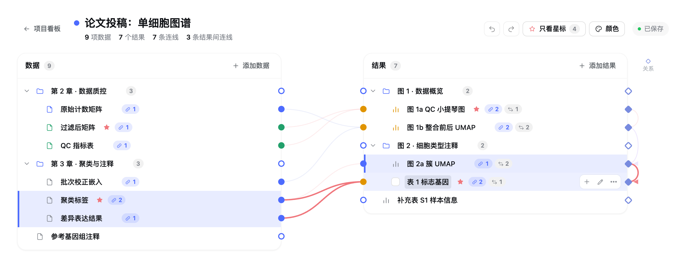

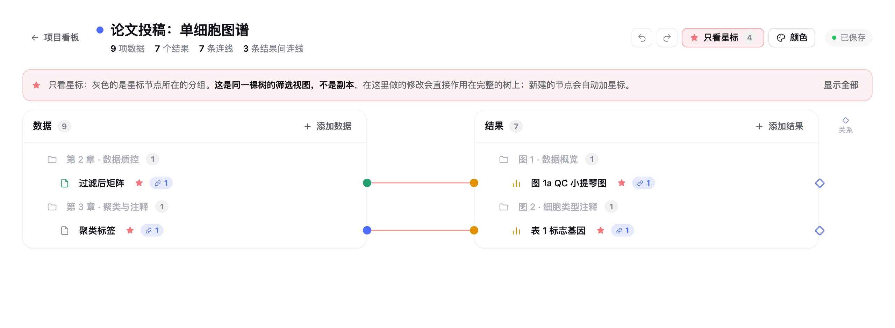

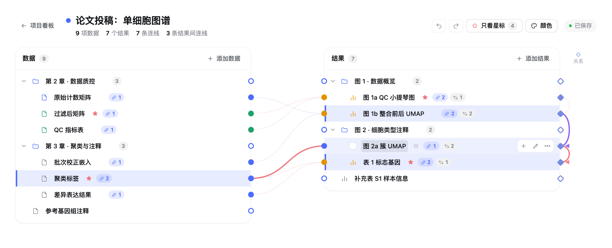

| 拖出结果间的连线：能接的关系点亮起，线吸附在目标的关系点上 | 悬停在结果间的线上：有向 / 无向、反向、类别、删除 |
| --- | --- |
| 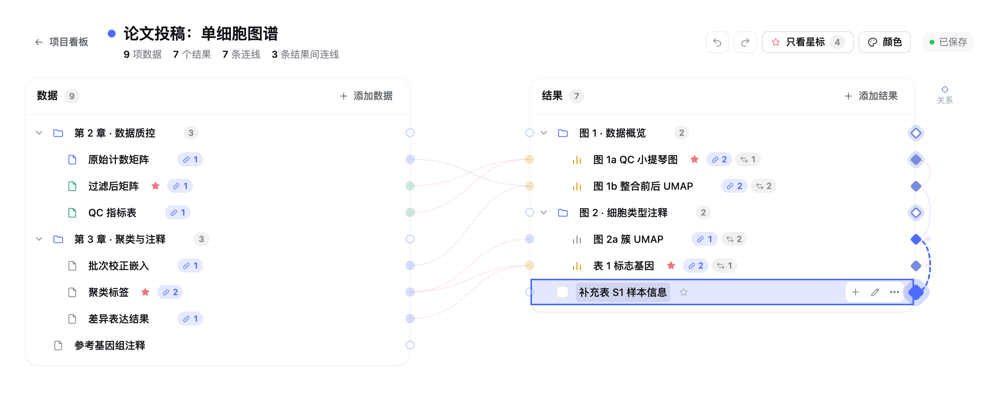 | 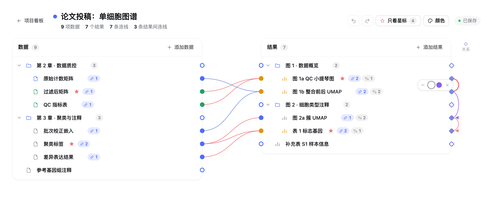 |

| 颜色与类别 | 窄窗口（约 380 px 宽） |
| --- | --- |
| 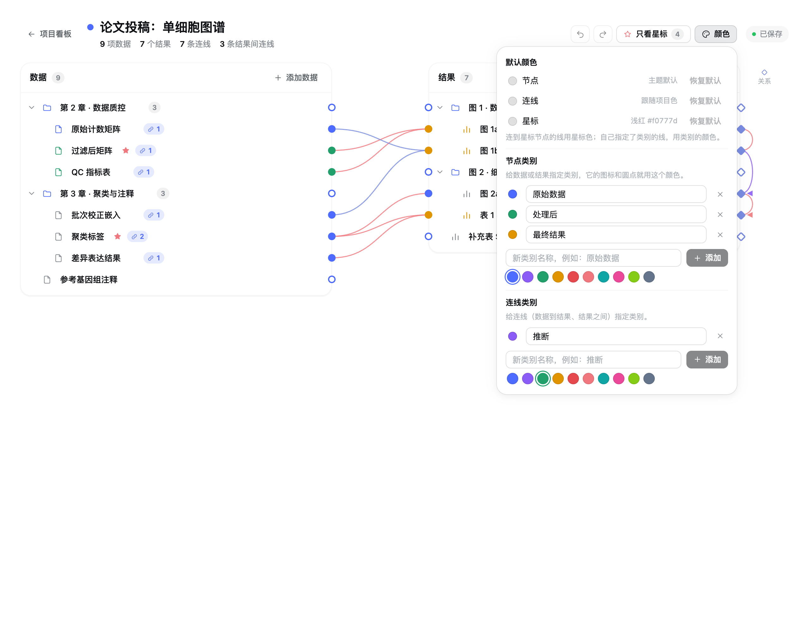 | 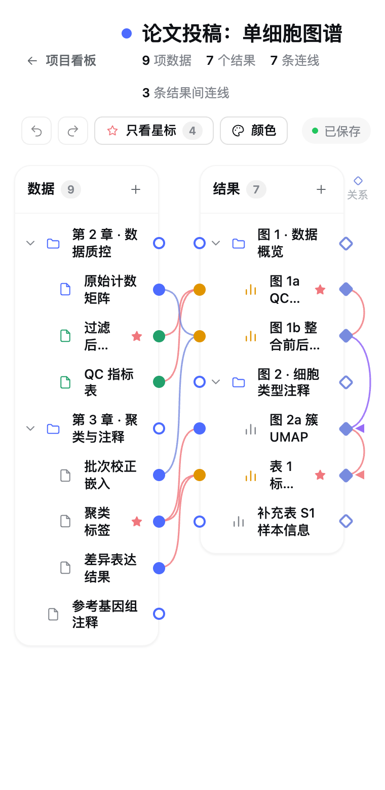 |

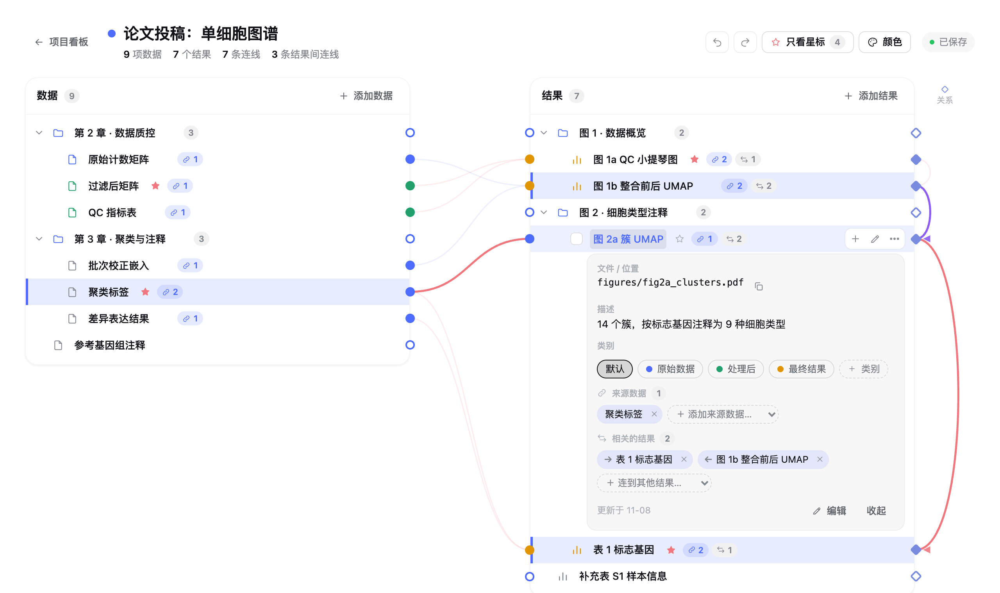

| 选中多项，合并为分组 | 深色主题 |
| --- | --- |
| 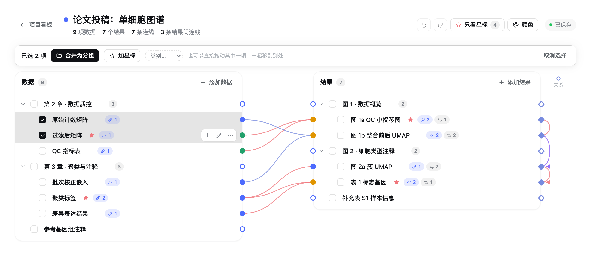 | 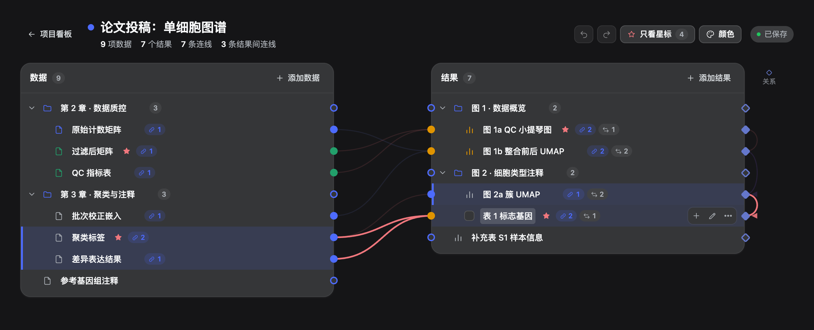 |

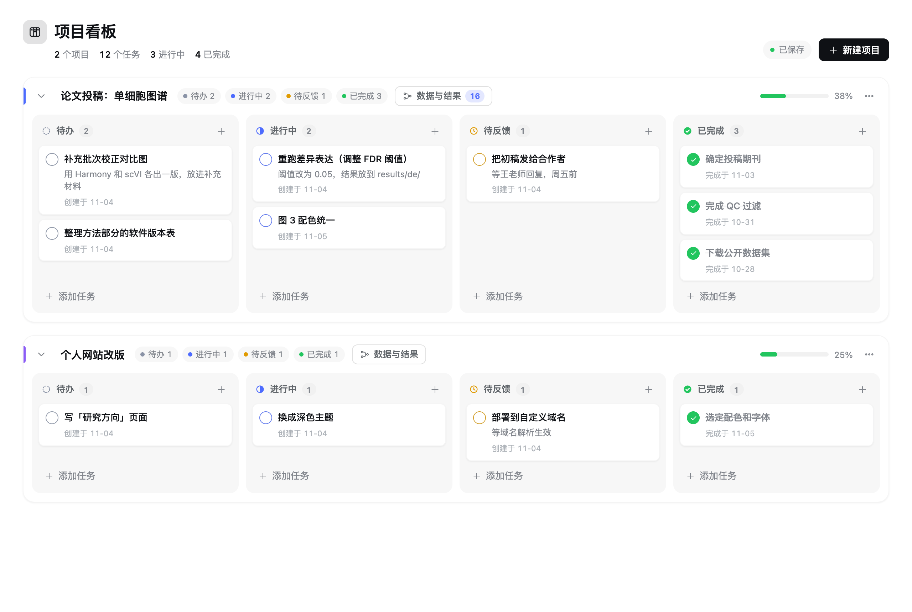

| 深色主题 | 任务菜单 | 编辑任务 |
| --- | --- | --- |
| 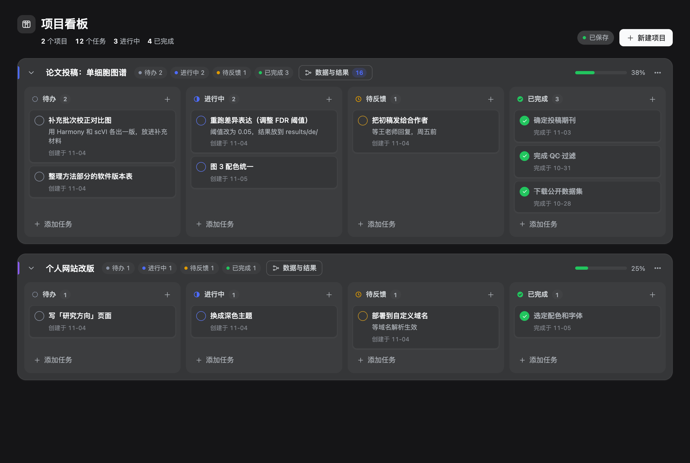 | 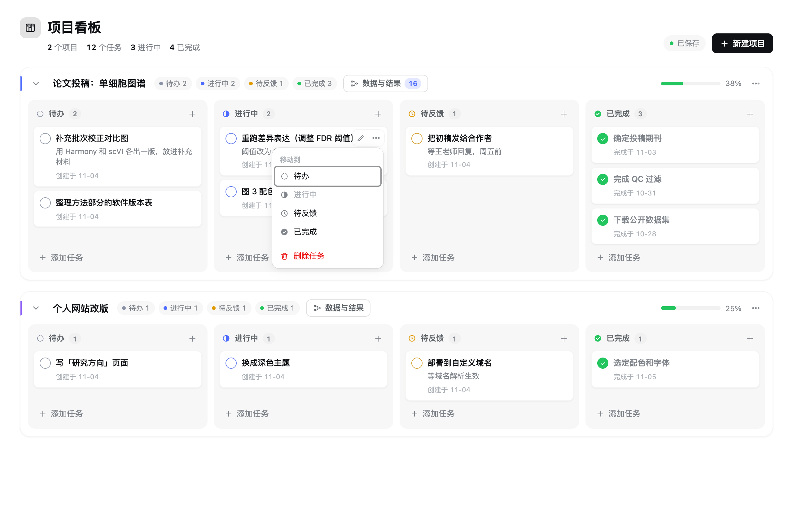 | 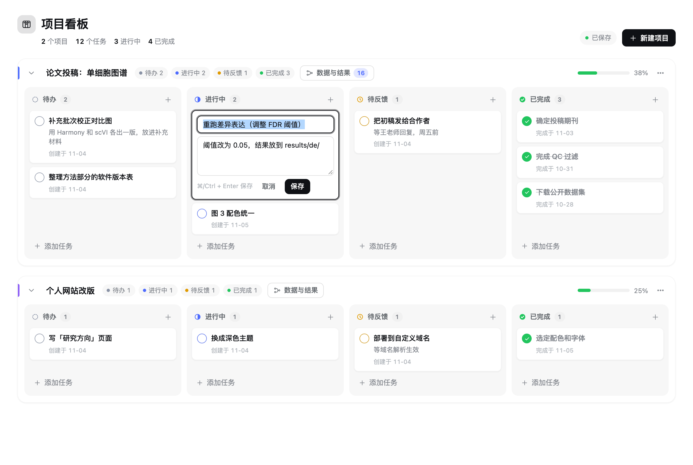 |

| 项目菜单 | 空状态 | 窄屏 |
| --- | --- | --- |
| 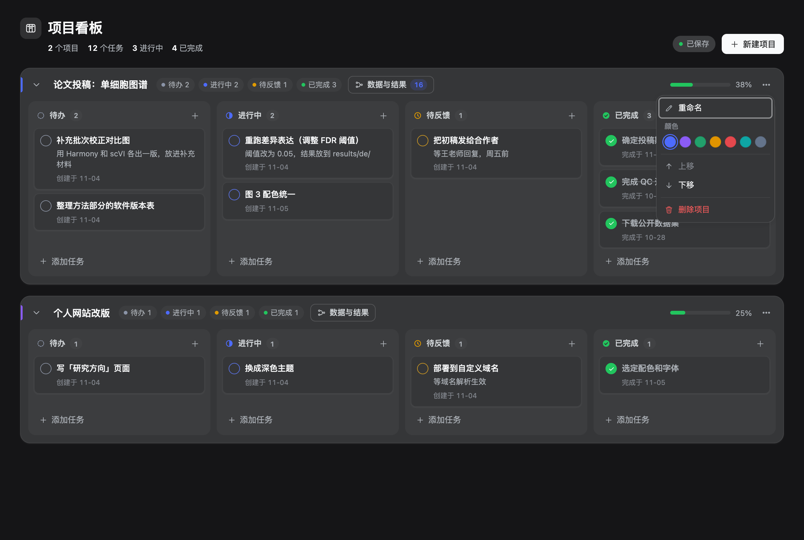 | 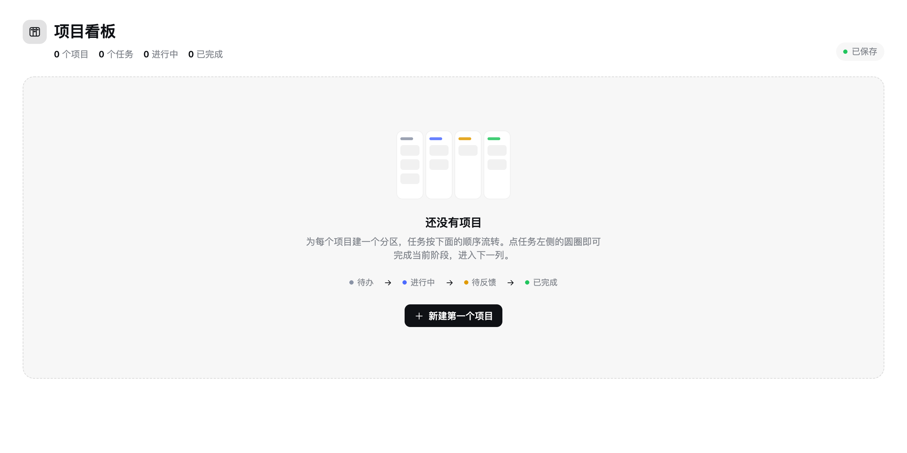 | 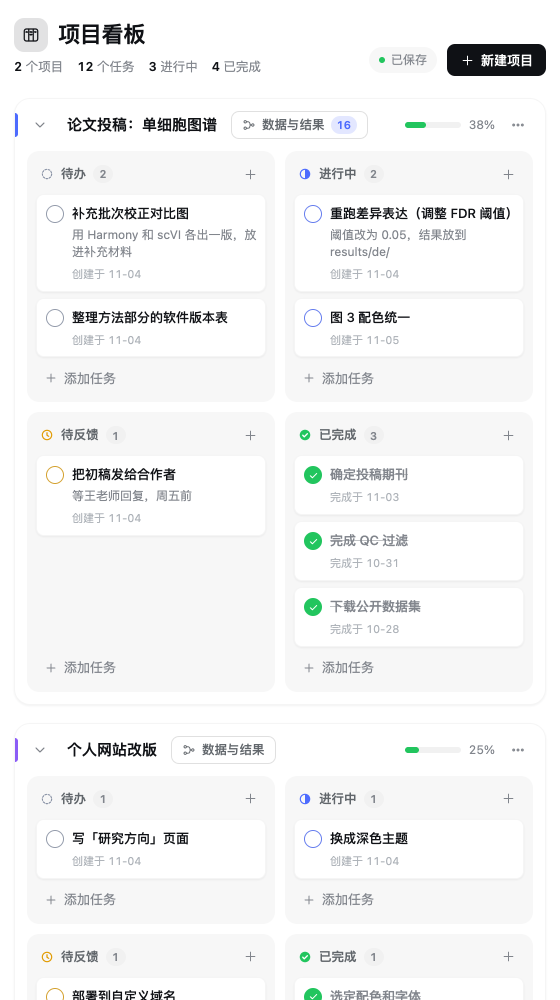 |

以上图片均为演示数据。

## 功能

- **侧边栏入口**：图标 + 「项目看板」，位于「插件市场」与「定时任务」之间。
- **按项目分区**：每个项目一个区块，显示各列计数和完成进度条；可折叠、重命名（项目「⋯」菜单）、换颜色、上移/下移、删除（需确认）。点项目名，或点标题栏里的「数据与结果」，进入这个项目的数据与结果页。
- **添加**：新建项目（名称 + 颜色）；在任意列点「添加任务」或列头「＋」，输入标题（可加备注），回车保存并可连续录入。
- **完成即流转**：点任务左侧圆圈 = 完成当前阶段，任务移到右侧下一列的**最上方**，并有短暂高亮。已完成列的圆圈是静态的绿色勾，不会误触。
- **手动调整**：拖拽卡片到同一项目的任意列/位置；或用卡片「⋯」菜单「移动到」（含「重新打开（待办）」）。
- **编辑/删除**：卡片悬停出现编辑按钮（或双击卡片）；删除后底部提示可「撤销」。
- **空状态**：无项目时显示引导与流转说明；空列显示提示文案。
- **外观**：颜色/圆角/阴影全部取自 DSH 主题变量，自动跟随 DSH 的浅色/深色主题；按主区域宽度自适应（宽屏 4 列，中等 2×2，窄屏单列）。「数据与结果」页在窄窗口（约 640 px 以下）隐藏行内的计数标签，约 460 px 以下名字最多折成两行、「添加」按钮只留 +，两棵树始终并排。

## 数据与结果

点项目名（或标题栏里的「数据与结果」）进入这个项目的页面，把关键数据和得到的结果记下来；左上角「项目看板」回到看板。

- **两棵树。** 左边是**数据树**，右边是**结果树**。每个节点有三项：**简单名字**（树里只显示它）、**完整路径**、**描述**（结果树里「完整路径」叫「文件 / 位置」）。点名字展开卡片，看到这一条的全部信息，路径可一键复制，也可以在卡片里编辑；再点一次收起。
- **合并成章节。** 任何节点都可以有子节点，只写了名字的节点就是章节。把一个节点**拖到另一个节点的中间**，它就并入那个节点；拖到一行的**上 / 下边缘**，排在它前 / 后；拖到树底部的空白处，回到最上层。点节点左侧的图标（或 ⌘ / Ctrl / Shift + 点名字）可以选中多项，然后「**合并为分组**」一次把它们收进一个新分组（马上可以改名），也可以直接拖动其中一项，整组一起走。不方便拖的时候，用节点的「⋯」菜单：上移、下移、移入上一项、移出上一级、解散（子节点上移）、删除。
- **连线。** 数据树靠右、结果树靠左的边缘上，每一行有一个圆点：**从一个圆点拖到另一侧的节点上**（反过来也行），就连上一条线，表示这个结果来自这份数据。一份数据可以连多个结果，一个结果也可以有多个来源；一对节点只连一条。悬停或点选一个节点，它的线和另一侧相关的节点会亮起，其余变淡；悬停在线上出现「×」可以删除；点一下线（选中它），按 Delete（Mac 的 delete 键）也行，⌘Z 可以撤回。分组折叠后，里面的线汇到分组那一行（虚线）。不想拖的话，也可以在卡片里用「＋ 关联结果…」「＋ 添加来源数据…」下拉选择。
- **星标与「只看星标」。** 节点名字右边的 ☆ 点一下就是星标（菜单里还有「整组加星标」，选中多项后也能批量加）。**连到星标节点的线用浅红色**（星标色可以改），页头的数字是星标总数。页头的「只看星标」只显示加了星标的节点，它们所在的分组灰色显示，线也只画星标和星标之间的。**这只是同一份数据的筛选视图，不是副本**：在里面添加、拖动、连线、删除，改的都是完整的树，点「显示全部」一切都在；在这个视图里新建的节点会自动加星标，免得一建好就从视图里消失。
- **撤销 / 重做。** 在这个页面里 **⌘Z 撤销，⇧⌘Z 重做**（Windows / Linux 用 Ctrl；Ctrl+Y 也是重做），页头也有对应的按钮，悬停会写出要撤销的是哪一步。添加、编辑、拖动、合并、解散、删除、连线、星标、类别和颜色，每个动作都是一步；折叠 / 展开不算。撤销只撤回你做的那一步，别的对话在这期间写进来的内容不会被冲掉；在输入框里打字时 ⌘Z 仍是文字自己的撤销。历史按项目保存在页面里，离开再回来还在，刷新页面后清空。
- **结果之间也能连线。** 每个结果的**最右边**有一个菱形的**关系点**，和连数据用的圆点是两个不同的点（圆点在左边，只连数据；菱形在右边，只连结果），右边那一列的顶上标着「关系」。从菱形拖到另一个结果上，就连出一条结果之间的线，画在结果树右边的空白里，表示它们有关系（比如一个结果依赖另一个）；拖的时候，能接的关系点亮起、圆点退到后面，线会吸附在目标的关系点上；已经连过的结果不会亮（一对结果只连一条）。**默认无向**；松开时按住 Option / Alt 就是有向（带箭头，从拖出的结果指向目标）；之后悬停在线上，浮出的小工具条（在线的旁边，不压在线上）可以切换有向 / 无向、反向、选连线类别、删除；点选这条线再按 Delete 同样能删；结果的卡片里也能增删、切换。
- **颜色。** 页头的「颜色」：**默认颜色**（节点、连线、星标各一个，可以恢复默认）和**类别**——先「新增节点类别 / 连线类别：名字 + 颜色」（比如「原始数据」蓝、「最终结果」橙），再给节点指定类别（卡片里点类别，或选中多项后在批量栏里选），给连线指定类别（悬停在线上，工具条上的小圆点）。节点的图标和圆点用类别色；线用类别色，没指定类别时连到星标节点的线用星标色，其余用默认连线色。颜色是 `#RRGGBB`，有 10 个一键色板，也可以直接输入。删除类别后，用了它的回到默认。
- **撤销提示。** 删除节点（含子节点）、解散分组、删除连线、删除类别后，底部提示条上也有「撤销」；删除带子节点的分组会先确认。
- **自动保存。** 和看板一样，改动立即显示、后台保存；分组的折叠状态也会记住。

### 让别的对话来整理

别的对话可以通过本机接口（`GET /project-kanban/board`、`POST /project-kanban/ops`）直接读写项目的数据树、结果树、连线、星标和类别，例如让它分析一个项目文件夹，自己把关键数据和结果记进来并连好线。接口说明、可以直接用的示例脚本和注意事项见 [docs/AGENT.md](docs/AGENT.md)；对它说「先读这份文档，再整理项目 X」即可。

数据和任务存在同一个文件里（见下），每个项目多一个 `records` 字段：

```jsonc
"records": {
  "data":    [ { "id": "n_…", "name": "过滤后矩阵", "path": "/data/qc/filtered.h5ad", "description": "…",
                 "parentId": "n_…" /* 或 null */, "collapsed": false, "createdAt": "…", "updatedAt": "…" } ],
  "results": [ /* 同上 */ ],
  "links":   [ { "id": "l_…", "dataId": "n_…", "resultId": "n_…", "createdAt": "…" } ]
}
```

后加的几项都是可选的，没用过就不出现，旧文件照常读取：节点的 `starred: true`、`category`（类别 id）；连线的 `category`；`relations`（结果之间的连线：`{ id, fromId, toId, directed?: true, category?, createdAt }`）；`palette`（`{ nodeCategories: [{ id, name, color }], edgeCategories: [...], defaults?: { node?, edge?, star? } }`）。

数组按「父节点在前、子树紧随其后」排列，同一个父节点的子节点顺序就是它们在数组里的先后；手工改过文件也没关系，载入时会自动整理（丢弃坏节点、悬空的连线，打断循环）。

## 需求假设（原需求中的待确认项）

| 待确认项 | 采用的假设 |
| --- | --- |
| 「个性化添加」的范围 | 添加/编辑/删除**项目**（名称、颜色）和**任务**（标题、可选备注）。**不含**自定义列、自定义字段——四列保持固定。 |
| 完成后「自动移动到下一项」 | 移到**右侧相邻列**（待办→进行中→待反馈→已完成），不是直接跳到已完成。 |
| 在「已完成」列再次点击 | 不做任何事（显示静态勾）。如需退回，用「⋯ → 移动到 / 重新打开」。 |
| 视觉风格 / 暗色 / 响应式 | 跟随 DSH 设计变量与主题（含暗色），按主区域宽度响应式布局。 |
| 「简单名字（完全路径（数据描述））」 | 每个节点三项：名字（必填，≤ 80 字）、完整路径（≤ 1000 字）、描述（≤ 4000 字）；树里只显示名字，点开卡片看全部。没有单独的「分组」类型，只写名字的节点就是分组。 |
| 「按自定义方式拖拽合并」 | 任何节点都能有子节点（最多 12 层）：拖进去 = 并入；也可以多选后一键合并成新分组。 |
| 「结果树状图」 | 结构和数据树完全一样（名字 / 位置 / 描述，可分组、可拖动）；数据树与结果树之间不能互相拖节点。 |
| 「让我自己把数据和结果连线」 | 只在「数据 → 结果」之间连线，多对多，一对节点只能连一条；同一棵树内部不连线。分组节点也可以连线（代表这一整组）。 |
| 「星标」「浅红色连线」 | 数据节点和结果节点都能加星标；一条线只要有一端是星标节点，就用星标色（默认浅红 `#f0777d`，可改）；自己指定了类别的线用类别色。 |
| 「只看星标」下的编辑 | 它是筛选视图不是副本：改动直接作用在完整的树上，所以不需要「同步」。视图里不显示折叠；新建的节点自动加星标；删除分组时会提示有多少子节点被视图隐藏。 |
| 「⌘Z / ⌘⇧Z」 | 只在数据与结果页里生效，按「一个动作 = 一步」，最多 100 步，刷新页面后清空；任务看板上没有。 |
| 「结果间连线」 | 只在结果和结果之间，默认无向，有向时箭头指向目标；一对结果只连一条；连在每个结果最右边的菱形关系点上，画在结果树右边（不和数据连线共用左边的圆点）。数据和数据之间不连线。 |
| 「新增节点 / 边类别：颜色」 | 每个项目自己的一套类别（节点和连线各最多 40 个）和三个默认色；节点或连线最多属于一个类别。 |
| 点项目名 | 改为进入项目的数据与结果页；重命名在项目的「⋯」菜单里。 |
| 数据存放位置 | 宿主机本地文件 `~/.dsh/project-kanban/board.json`（可用环境变量 `DSH_PROJECT_KANBAN_FILE` 改）。只在本机，无同步、无权限、无统计（未确认，不扩展）。 |

## 安装与运行

需要 Node ≥ 22.19。

```bash
cd ~/dsh-plugins/dsh-project-kanban
npm install
npm run build        # 生成 lib/index.js（宿主端）和 lib/client.js（浏览器端）
npm test             # 270 个测试
```

装入 DSH（链接方式，改代码后重新 build 即可）：

- 在 DSH 会话里让 Agent 调用 `plugin_manager install_bundle`，target 为 `link:/Users/yhan0/dsh-plugins/dsh-project-kanban`；或命令行 `dsh plugin --profile desktop add link:<本目录>`。
- 插件条目 id：`include:project-kanban`。停用/启用：`plugin_manager set_plugin include:project-kanban enabled=false/true`。
- 修改宿主端代码后需停用再启用（或重启 DSH）；修改浏览器端代码后刷新 DSH 页面即可。

## 结构

```
src/
  shared/board.ts      数据模型 + 所有操作（纯函数，宿主与浏览器共用）
  shared/records.ts    数据 / 结果两棵树、连线、结果间连线、星标、类别的模型与操作（同上），含载入时的修复
  shared/records-history.ts  每个操作的「反向操作」，撤销 / 重做靠它
  shared/text.ts       id 与文本的通用规则
  shared/protocol.ts   接口路径与请求/响应类型
  store.ts             board.json 读写（临时文件 + 重命名，坏文件自动另存）
  routes.ts            GET /project-kanban/board、POST /project-kanban/ops
  index.ts             宿主端入口：把路由挂到 DSH webServer
  client/index.tsx     浏览器端入口：注册 sidebar.panellist（入口）与 main（看板）
  client/sync.ts       乐观更新 + 有序批量保存 + 断线重试
  client/KanbanView.tsx 看板界面（含「点项目进入详情页」的导航）
  client/common.tsx    看板与详情页共用：操作上下文、菜单、保存状态
  client/RecordsView.tsx 数据与结果页：状态、拖拽合并、连线层与测量
  client/RecordTree.tsx  一棵树：行、卡片、表单
  client/recordsModel.ts 纯函数：展开哪些行、落点、高亮、连线形状
  client/recordsContext.ts 详情页的上下文类型
  client/recordsHistory.ts 撤销历史（每个项目一份）
  client/PalettePanel.tsx  「颜色」面板：默认色和类别
  client/styles.ts     样式（DSH 主题变量）
  client/icons.tsx     SVG 图标
tests/                 board / records / host / sync / view / records-view 等测试
```

### 数据一致性设计

- 每次改动都是一个「操作」（如 `task.advance`），浏览器先在本地应用（界面即时更新），再按顺序批量发给宿主；界面始终 =「宿主确认的看板 + 尚未确认的操作」重放，宿主回包后用宿主的看板重建，不做局部修补。
- 所有操作可安全重试：新增带浏览器生成的 id（重复会被拒绝）；`task.advance` 带「起始列」，任务已不在该列则拒绝，所以快速连点或网络重发**不会跳列、不会重复、不会丢失**。
- 一次请求最多 200 个操作且不超过约 384KB，超出自动分批；断线时操作保留在队列中，1s/2s/4s/8s/15s 退避重试，状态显示「未连接，稍后自动重试」。

## 协作说明

本插件由 Claude（架构、核心逻辑、界面）与 DeepSeek V4.1 Flash（DSH Agent Team 成员，编写测试与代码审查）协作完成；DeepSeek 审查发现的「离线积压超过 200 个操作会整批丢失」问题已修复，其复现测试现已通过。

## 安装

```bash
dsh plugin --profile web add github:HanYu-me/dsh-project-kanban
# 桌面版：dsh plugin --profile desktop add github:HanYu-me/dsh-project-kanban
```

需要 dsh `>= 0.2.0-rc.1 < 0.3.0`。装好后重启 dsh。也可以从 [Releases](https://github.com/HanYu-me/dsh-project-kanban/releases) 下载预构建的 `dsh-project-kanban.tgz`。

## 许可

[Apache-2.0](./LICENSE) © Yu Han
